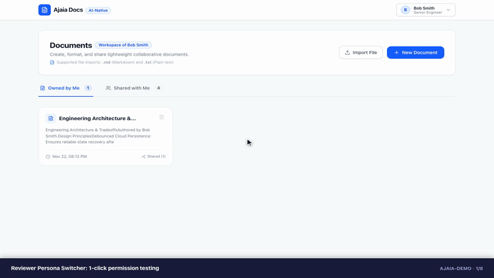

# Ajaia Docs — AI-Native Collaborative Document Editor

A lightweight, high-performance collaborative document editor inspired by Google Docs, built for internal teams to move faster on shared work.

**Live Deployment URL:** [https://ajaia-app-ruddy.vercel.app](https://ajaia-app-ruddy.vercel.app)  
**Walkthrough Video:** `ajaia_walkthrough_demo.mp4` (Actual recorded footage encoded in 1080p H.264 via FFmpeg)



---

## Core Capabilities Delivered

1. **Rich-Text Document Creation & Editing**
   - Full WYSIWYG editing canvas powered by TipTap (ProseMirror).
   - Rich formatting: **Bold**, *Italic*, <u>Underline</u>, Strikethrough, Headings (H1, H2), Bulleted lists, Numbered lists, and Blockquotes.
   - Real-time inline document renaming.
   - Debounced cloud autosave (800ms) with visual status indicators (*Saving to cloud...* $\rightarrow$ *Saved at HH:MM*).

2. **File Ingestion Engine**
   - **Supported file formats:** Markdown (`.md`, `.markdown`) and Plain Text (`.txt`).
   - Drag-and-drop or file picker import that instantly parses file structures into editable documents with formatted headings, lists, and bold text.
   - Single-click export back to Markdown or HTML.

3. **Relational Sharing & Access Control**
   - Relational ownership model backed by PostgreSQL.
   - Role-based permissions: **Owner**, **Editor** (can edit), and **Viewer** (read-only mode with disabled editor canvas).
   - Instant 1-click **Reviewer Persona Switcher** in the top navigation to evaluate cross-user permissions without registration barriers:
     - **Danniel Bacani** (`danniel@ajaia.io` - Product Lead)
     - **Bob Smith** (`bob@ajaia.io` - Senior Engineer)
     - **Charlie Davis** (`charlie@ajaia.io` - Design Partner)
   - Clear visual workspace separation between **"Owned by Me"** and **"Shared with Me"** tabs.

4. **Persistence & Engineering Rigor**
   - Persistent cloud storage on **Neon PostgreSQL** via **Prisma ORM**.
   - Zero state loss on refresh.
   - Automated unit and integration test suite passing via **Vitest**.
   - Deployed on **Vercel** with optimized serverless routing.

---

## Reviewer Quick-Test Guide

1. Open the [Live URL](https://ajaia-app-ruddy.vercel.app).
2. The app defaults to **Danniel Bacani** (`danniel@ajaia.io`):
   - You will see Danniel's owned documents (*"Confidential: Q2 Product Strategy"* and *"Ajaia Product Roadmap Q1"*) and one document shared by Bob (*"Engineering Architecture & Tradeoffs"*).
3. **Test Editing:** Click on *"Ajaia Product Roadmap Q1"*. Type or reformat text. Observe the autosave badge in the top right.
4. **Test Sharing:** Click **"Share"**, add `charlie@ajaia.io` or grant `bob@ajaia.io` Editor access.
5. **Test Persona Switching:** Click the top-right persona menu and switch to **Bob Smith**. Inspect the *"Shared with Me"* tab to verify access permissions in real-time.
6. **Test File Upload:** On the Dashboard, click **"Import File"** and select the included `Sprint_Retrospective.md` file.

---

## Local Development Setup

### Prerequisites
- Node.js 20+
- npm or pnpm

### Quick Start
```bash
# 1. Clone or extract the project directory
cd ajaia-app

# 2. Install dependencies
npm install

# 3. Environment variables
# Copy .env.example to .env, then set DATABASE_URL to any Postgres (a free Neon/Supabase project works)
cp .env.example .env

# 4. Push database schema and seed test data
npx prisma db push
npm run db:seed

# 5. Run automated test suite
npm test

# 6. Start local development server
npm run dev
```

Open [http://localhost:3000](http://localhost:3000) to view the application.

---

## Submission Deliverables Index
- [ARCHITECTURE.md](./ARCHITECTURE.md) — Architecture decisions, trade-offs, and deliberate scope cuts.
- [AI_WORKFLOW.md](./AI_WORKFLOW.md) — Practical AI tool usage, rejected patterns, and verification discipline.
- [SUBMISSION.md](./SUBMISSION.md) — Submission manifest and checklist.
- `ajaia_walkthrough_demo.mp4` — High-definition walkthrough video recorded on the live deployment.
